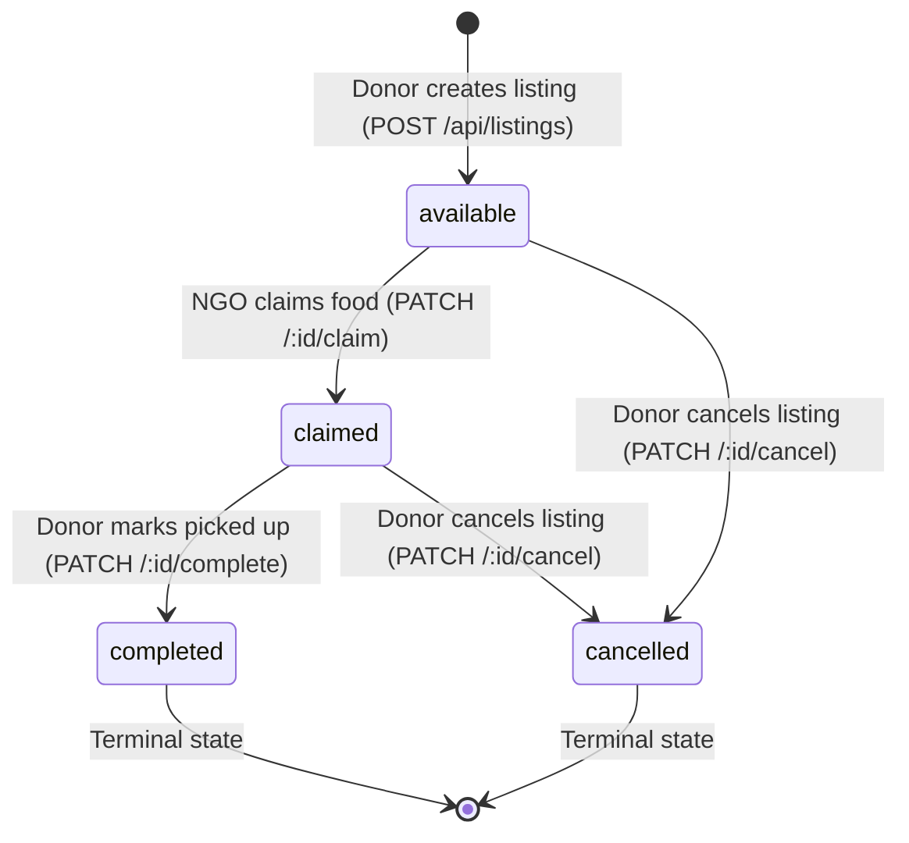

# AnnaSeva (FoodBridge) — Engineering Progress Report: Day 4

**Project:** AnnaSeva / FoodBridge (Surplus Food Redistribution Platform)  
**Milestone:** Day 4 — The Claim System & System-Design Lab  
**Technology Stack:** Node.js, Express.js (v5), MongoDB Atlas, Mongoose (v9), Atomic State Transitions, Concurrency Testing, Query Plan Optimization  
**Repository:** [https://github.com/iABM3568/AnnaSeva_](https://github.com/iABM3568/AnnaSeva_)  
**Current Branch:** `main` (Synced with GitHub)

---

## Executive Summary

On **Day 4**, we addressed the core concurrency challenge of AnnaSeva: **guaranteeing that when multiple NGOs attempt to claim the exact same surplus food listing at the exact same millisecond, exactly ONE claim succeeds and all competing claims receive a clean conflict error.**

We also implemented the complete listing lifecycle state machine (`available` $\to$ `claimed` $\to$ `completed` / `cancelled`), created an automated demo database seeder, executed a 20-request simultaneous race condition test, and profiled MongoDB query performance using `explain('executionStats')`.

---

## 1. Core Architectural & System Design Concepts

### 1.1 Race Conditions & The "Check-Then-Update" Flaw
* **The Flaw:** In naive implementations:
  1. Server checks if food is available (`const listing = await Listing.findById(id); if (listing.status === 'available') ...`)
  2. Server updates food (`listing.status = 'claimed'; await listing.save();`)
* **The Vulnerability:** In the gap between Step 1 and Step 2, multiple concurrent requests also read `available`, passing the check simultaneously. Both mark the listing as claimed, resulting in a single food batch being promised to two different NGOs.

### 1.2 Atomic Transitions via `findOneAndUpdate` (ADR 004)
* **The Solution:** We convert the check and the update into **one indivisible operation** evaluated at the database engine level:
  ```javascript
  const listing = await Listing.findOneAndUpdate(
    { _id: id, status: 'available', expiresAt: { $gt: new Date() } },
    { status: 'claimed', claimedBy: req.user.id, claimedAt: new Date() },
    { returnDocument: 'after' }
  );
  ```
* **Why it works:** MongoDB processes document-level updates sequentially. The first request updates `status` to `'claimed'`. The remaining 19 competing requests find zero matching documents and receive a `409 Conflict`.

### 1.3 The State Machine & Transition Rules



* `available` $\to$ `claimed`: Enforced by atomic condition `{ status: 'available', expiresAt: > now }`.
* `claimed` $\to$ `completed`: Enforced by ownership filter `{ _id, donor: req.user.id, status: 'claimed' }`.
* `available` / `claimed` $\to$ `cancelled`: Enforced by `{ _id, donor: req.user.id, status: { $in: ['available', 'claimed'] } }`.
* `completed` and `cancelled` cannot be modified by any caller.

### 1.4 Status Code Precision & Privacy (404 vs 409 vs 403 vs 400)
| Status | Semantic Meaning in AnnaSeva | Example |
|---|---|---|
| `400 Bad Request` | Syntactically invalid input | Request sent with malformed ID `abc` (caught by `validateId`) |
| `401 Unauthorized` | Missing or invalid authentication token | Calling without `Authorization: Bearer <token>` |
| `403 Forbidden` | Valid token, but user role is not authorized | Donor calling `PATCH /:id/claim` or NGO calling `PATCH /:id/complete` |
| `404 Not Found` | Resource does not exist, or belongs to another donor | Donor B attempting to complete or cancel Donor A's listing |
| `409 Conflict` | Resource exists, but its state prevents this transition | Attempting to claim already-claimed or expired food |

> [!NOTE]
> **Anti-IDOR Existence Privacy:** If Donor B tries to alter Donor A's listing, we return `404 Not Found` rather than `409` or `403`. This prevents malicious users from confirming whether a private listing ID exists on the platform.

---

## 2. Lab Experiments & Verification Results

### 2.1 Concurrency Race Test (`server/scripts/race-test.js`)
We fired **20 concurrent HTTP requests simultaneously** at a single fresh available listing using `Promise.all`:

```text
Statuses received: 200 409 409 409 409 409 409 409 409 409 409 409 409 409 409 409 409 409 409 409
Summary breakdown: { '200': 1, '409': 19 }
Result: ✅ PASS (Exactly ONE winner, 19 conflicts!)
```

### 2.2 Index Performance Benchmark (`server/scripts/explain-lab.js`)
We benchmarked MongoDB query execution on 3,000 documents with and without the `{ donor: 1, createdAt: -1 }` index:

| Metric | WITH Index (`IXSCAN`) | WITHOUT Index (`COLLSCAN`) | Performance Impact |
|---|---|---|---|
| **Execution Plan** | `IXSCAN` (Index Scan) | `COLLSCAN` (Collection Scan) | Index traversed directly |
| **Documents Examined** | **15** | **3,016** | **200x fewer documents read** |
| **Documents Returned** | 15 | 15 | Identical output |
| **Execution Time** | **0 ms** | 2 ms | Eliminates full table scan |

---

## 3. Full Day 4 Lifecycle Test Results

| # | Test Scenario | Target Endpoint | Expected Status | Result |
|---|---|---|---|---|
| 1 | Database Seeding | `node scripts/seed.js 15` | 15 listings seeded | **PASS ✅** |
| 2 | Simultaneous 20-Request Race | `PATCH /api/listings/:id/claim` | 1 winner (200), 19 conflicts (409) | **PASS ✅** |
| 3 | Claim Already Claimed Listing | `PATCH /api/listings/:id/claim` | 409 Conflict | **PASS ✅** |
| 4 | Claim Non-Existent Listing | `PATCH /api/listings/:id/claim` | 404 Not Found | **PASS ✅** |
| 5 | Malformed ID (`abc`) | `PATCH /api/listings/abc/claim` | 400 Bad Request (via `validateId`) | **PASS ✅** |
| 6 | Donor Attempts Claim | `PATCH /api/listings/:id/claim` | 403 Forbidden | **PASS ✅** |
| 7 | Owner Completes Claimed Listing | `PATCH /api/listings/:id/complete` | 200 OK (`status: "completed"`) | **PASS ✅** |
| 8 | Complete Non-Claimed Listing | `PATCH /api/listings/:id/complete` | 409 Conflict | **PASS ✅** |
| 9 | Foreign Donor Completes Listing | `PATCH /api/listings/:id/complete` | 404 Not Found (Privacy safe) | **PASS ✅** |
| 10 | Cancel Completed Listing | `PATCH /api/listings/:id/cancel` | 409 Conflict | **PASS ✅** |
| 11 | Owner Cancels Available Listing | `PATCH /api/listings/:id/cancel` | 200 OK (`status: "cancelled"`) | **PASS ✅** |
| 12 | Query Plan Profiling | `node scripts/explain-lab.js` | IXSCAN vs COLLSCAN proven | **PASS ✅** |

---

## 4. Components Created & Modified

### Created Files
* [`server/middleware/validateId.js`](file:///Users/iabm3568/AnnaSeva2/server/middleware/validateId.js): Validates 24-character hexadecimal MongoDB ObjectIds before hitting database layers.
* [`server/scripts/seed.js`](file:///Users/iabm3568/AnnaSeva2/server/scripts/seed.js): Development seeding utility generating demo accounts (`donor.demo@example.com`, `ngo.demo@example.com`) and 15 geographically dispersed listings.
* [`server/scripts/race-test.js`](file:///Users/iabm3568/AnnaSeva2/server/scripts/race-test.js): Automated concurrency testing harness firing 20 simultaneous requests.
* [`server/scripts/explain-lab.js`](file:///Users/iabm3568/AnnaSeva2/server/scripts/explain-lab.js): Index profiling script demonstrating `IXSCAN` vs `COLLSCAN`.

### Modified Files
* [`server/controllers/listing.controller.js`](file:///Users/iabm3568/AnnaSeva2/server/controllers/listing.controller.js): Added `claimListing`, `completeListing`, `cancelListing`, and `failTransition` helper.
* [`server/routes/listing.routes.js`](file:///Users/iabm3568/AnnaSeva2/server/routes/listing.routes.js): Mounted `PATCH /:id/claim`, `PATCH /:id/complete`, and `PATCH /:id/cancel`.
* [`docs/decisions.md`](file:///Users/iabm3568/AnnaSeva2/docs/decisions.md): Added **ADR 004** (Atomic State Transitions via `findOneAndUpdate`).
* [`docs/journal.md`](file:///Users/iabm3568/AnnaSeva2/docs/journal.md): Documented Day 4 concurrency principles, status code semantics, and query profiling notes.
* [`.thunderclient/thunder-collection_FoodBridge.json`](file:///Users/iabm3568/AnnaSeva2/.thunderclient/thunder-collection_FoodBridge.json): Added folder 3 ("Claim & Lifecycle") with all test requests.

---

## 5. Git Commit Log

```text
* 6321147 (HEAD -> main, origin/main, feature/claim) docs(claim): add ADR 004, explain-lab benchmark, and Thunder Client collection
* ee9d04d feat(claim): implement atomic claim, complete, and cancel lifecycle handlers
* e550f68 feat(claim): add validateId middleware, seed script and race test lab
* 76f790e docs: add comprehensive Day 3 progress report
```

---

## 6. Readiness for Day 5

The backend API is now fully capable of:
1. User registration & authentication (`donor`, `ngo`)
2. Food listing publication with GeoJSON coordinates
3. Geospatial discovery within configurable radii
4. Concurrency-safe atomic claiming and lifecycle transitions

We are ready for **Day 5: React, Login Screens and the First Deploy**!

