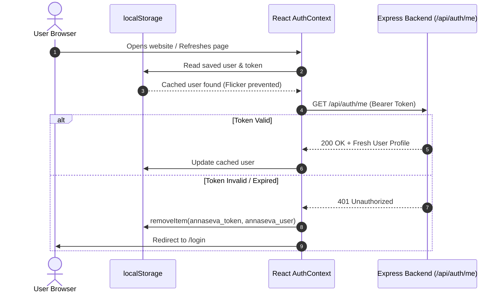

# AnnaSeva — Engineering Progress Report: Day 5

**Project:** AnnaSeva (Surplus Food Redistribution Platform)  
**Milestone:** Day 5 — React Frontend, Authentication & First Deployment  
**Technology Stack:** React 19, Vite 6, Tailwind CSS v4, React Router v7, Axios, Express 5, MongoDB Atlas, Mongoose 9  
**Repository:** [https://github.com/iABM3568/AnnaSeva_](https://github.com/iABM3568/AnnaSeva_)  
**Current Branch:** `main` (Synced with GitHub)

---

## Executive Summary

On **Day 5**, we transformed AnnaSeva from an API-only platform into a full-stack, responsive web application. 

We scaffolded a high-performance React single-page application using Vite, configured Tailwind CSS v4 and React Router v7, established a centralized Axios client with automatic Bearer token interceptors, built persistent authentication state using React Context, implemented role-guarded routes (`/donor` and `/ngo`), and verified the entire authentication lifecycle (registration, login, refresh persistence, role enforcement, and clean logout) against the live MongoDB Atlas database.

All code has been committed with conventional commits, merged into `main`, and pushed to GitHub.

---

## 1. Initial Repository Assessment (Phase 0)

| Area | Verified Backend Behavior | Frontend Integration Contract |
|---|---|---|
| **Root Structure** | Monorepo layout with `/server` and `/client` directories. | Client resides in root `/client`, server in `/server`. |
| **Auth Endpoints** | `POST /api/auth/register`, `POST /api/auth/login`, `GET /api/auth/me`. | Fully consumed by `client/src/services/api.js` and `AuthContext.jsx`. |
| **Registration Schema** | Zod schema expects `name` (2-80 chars), `email`, `password` (8-72 chars), `role` (`donor` or `ngo`), and optional `organization` (max 120 chars). | Form inputs in `Register.jsx` match backend rules exactly; invalid submissions surface human-readable Zod error messages. |
| **Response Formats** | Both login and register return `{ status: 'success', token, data: { user } }`. `GET /auth/me` returns `{ status: 'success', data: { user } }`. | `AuthContext` defensively extracts `data.data?.user || data.user` to handle both direct and nested responses. |
| **Security & RBAC** | Backend uses `protect` (JWT verification) and `restrictTo('donor' | 'ngo')`. | Frontend uses `ProtectedRoute` to redirect unauthorized users; real security remains enforced by backend HTTP 403s. |
| **CORS Support** | Dynamically configured in `server/app.js` to accept `CLIENT_URL` with preflight OPTIONS support and credentials. | Frontend sends cross-origin requests from `http://localhost:5173` without CORS blocks. |
| **Environment Config** | Client uses `VITE_API_URL` (`http://localhost:5000/api`) and `VITE_SOCKET_URL`. | Configured in `client/.env` and template `client/.env.example`. Secrets are strictly excluded from client builds. |

---

## 2. Core Concepts & Educational Explanations (Phase 1)

### 2.1 Single Page Application (SPA)
* **What it means:** The web browser downloads a single `index.html` file and a bundle of JavaScript once. As users navigate from the landing page to `/login` or `/donor`, React swaps components into the screen dynamically without reloading the entire browser page.
* **Analogy:** A theatre stage. Instead of tearing down the auditorium and building a new theatre for every scene, the stage remains in place while the stagehands swap the background scenery.

### 2.2 Components, Props, and State
* **Components:** Reusable JavaScript functions that return JSX (what to display on screen).
* **Props (Inputs):** Read-only data passed from a parent component down to a child (like arguments to a function).
* **State (Memory):** Internal data managed by a component (`useState`). When state changes, React automatically **re-renders** (redraws) the component on screen.
* **Analogy:** Props are the ingredients given to a baker; State is the oven temperature set by the baker.

### 2.3 React Context (`AuthContext`)
* **The Problem:** Passing the current user down through 5 or 6 nested components (*prop drilling*) clutters code and causes maintenance headaches.
* **The Solution:** A centralized state store that wraps the component tree. Any component can call `useAuth()` to access `user`, `loading`, `login()`, `register()`, and `logout()`.
* **Analogy:** A shared backpack. Any team member can reach in and grab what they need without asking three intermediate colleagues.

### 2.4 Session Persistence Strategy


### 2.5 Axios Interceptors
* **Request Interceptor:** An automated gateway that runs before every single HTTP request leaves the browser. It reads `localStorage.getItem('annaseva_token')` and injects `Authorization: Bearer <token>`, eliminating repetitive header boilerplate across pages.
* **Response Interceptor:** Catches `401 Unauthorized` responses. If a normal API request fails with a 401 (e.g. token expired while viewing listings), it purges stored credentials and redirects to `/login`. Explicit exceptions are granted for `/auth/login` and `/auth/register` so credential errors are displayed directly in the form.

### 2.6 Controlled Form Inputs
In `Login.jsx` and `Register.jsx`, form input values are bound to React state:
```jsx
<input name="email" value={form.email} onChange={handleChange} />
```
Every keystroke updates state, making React the single source of truth and enabling real-time validation, disabled submit buttons during flight, and automated payload sanitization.

### 2.7 CORS (Cross-Origin Resource Sharing) & Preflights
* **The Mechanism:** Browsers block web pages on `localhost:5173` from reading responses from `localhost:5000` unless the server sends `Access-Control-Allow-Origin`.
* **Preflight (OPTIONS):** Because our requests contain custom headers (`Authorization`), browsers first send an invisible `OPTIONS` request asking "May I send this request with an Authorization header?" Our Express server's `cors()` middleware answers the preflight, authorizing the transaction.

---

## 3. Implementation Details (Phases 2 – 5)

### 3.1 Client Scaffolding
* Created modern Vite + React structure in `/client`.
* Integrated `@tailwindcss/vite` (Tailwind CSS v4) with `@import "tailwindcss";` in `src/index.css`.
* Cleaned up starter artifacts and ensured `dist/` and `.env` are excluded from Git via `.gitignore`.
* Added `client/vercel.json` with SPA rewrite rule:
  ```json
  {
    "rewrites": [{ "source": "/(.*)", "destination": "/index.html" }]
  }
  ```
  *Why it matters:* Prevents HTTP 404s when a user refreshes deep routes like `/donor` or `/ngo` on static hosting providers.

### 3.2 Authentication & State Architecture
* [`client/src/services/api.js`](file:///Users/iabm3568/AnnaSeva2/client/src/services/api.js): Centralized Axios instance with request and response interceptors.
* [`client/src/utils/errors.js`](file:///Users/iabm3568/AnnaSeva2/client/src/utils/errors.js): Formats network, validation, and API errors into human-readable messages.
* [`client/src/context/AuthContext.jsx`](file:///Users/iabm3568/AnnaSeva2/client/src/context/AuthContext.jsx): Provides session management, `useAuth()` hook, token verification on mount, and cached local storage fallback.
* [`client/src/components/Loader.jsx`](file:///Users/iabm3568/AnnaSeva2/client/src/components/Loader.jsx): Tailwind animated spinner and accessible status announcement.
* [`client/src/components/ProtectedRoute.jsx`](file:///Users/iabm3568/AnnaSeva2/client/src/components/ProtectedRoute.jsx): Guards routes by login state and role (`donor` / `ngo`).

### 3.3 Pages & Routing
* [`client/src/pages/Landing.jsx`](file:///Users/iabm3568/AnnaSeva2/client/src/pages/Landing.jsx): Welcome hero, value propositions for Donors and NGOs, dynamic CTA buttons.
* [`client/src/pages/Login.jsx`](file:///Users/iabm3568/AnnaSeva2/client/src/pages/Login.jsx): Email and password form, loading state, error display, role-based redirect.
* [`client/src/pages/Register.jsx`](file:///Users/iabm3568/AnnaSeva2/client/src/pages/Register.jsx): Full registration form with Donor/NGO radio selector, name, email, password (min 8 chars), optional organization field, and client-side sanitization matching backend Zod schema.
* [`client/src/pages/DonorDashboard.jsx`](file:///Users/iabm3568/AnnaSeva2/client/src/pages/DonorDashboard.jsx): Authenticated donor placeholder displaying profile information.
* [`client/src/pages/NgoNearby.jsx`](file:///Users/iabm3568/AnnaSeva2/client/src/pages/NgoNearby.jsx): Authenticated NGO placeholder displaying organization information.
* [`client/src/pages/NotFound.jsx`](file:///Users/iabm3568/AnnaSeva2/client/src/pages/NotFound.jsx): Custom 404 page with return link.
* [`client/src/components/Navbar.jsx`](file:///Users/iabm3568/AnnaSeva2/client/src/components/Navbar.jsx): Sticky navigation header displaying brand, authentication status, user role pill, and logout action.
* [`client/src/App.jsx`](file:///Users/iabm3568/AnnaSeva2/client/src/App.jsx): Main router configuration mapping `/`, `/login`, `/register`, `/donor`, and `/ngo`.

---

## 4. Local Integration & Build Verification (Phase 6)

### 4.1 Automated Backend Integration Test Matrix (`server/scripts/test-day5.js`)

| # | Test Scenario | Target Endpoint | Expected Status | Result |
|---|---|---|---|---|
| 1 | Health Check | `GET /api/health` | 200 OK (`status: 'ok'`) | **PASS ✅** |
| 2 | CORS Preflight Check | `OPTIONS /api/auth/login` | 200/204 with `Access-Control-Allow-Origin: http://localhost:5173` | **PASS ✅** |
| 3 | Donor Registration | `POST /api/auth/register` | 201 Created (`role: 'donor'`, JWT token) | **PASS ✅** |
| 4 | NGO Registration | `POST /api/auth/register` | 201 Created (`role: 'ngo'`, JWT token) | **PASS ✅** |
| 5 | Valid Login | `POST /api/auth/login` | 200 OK (JWT token and user data) | **PASS ✅** |
| 6 | Invalid Password Login | `POST /api/auth/login` | 401 Unauthorized ("Invalid email or password") | **PASS ✅** |
| 7 | Short Password Validation | `POST /api/auth/register` | 400 Bad Request (`password: >= 8 characters`) | **PASS ✅** |
| 8 | Invalid Role Validation | `POST /api/auth/register` | 400 Bad Request (`role: 'donor' or 'ngo'`) | **PASS ✅** |
| 9 | Duplicate Email Registration | `POST /api/auth/register` | 409 Conflict ("Account already exists") | **PASS ✅** |
| 10 | Profile Retrieval (Session verification) | `GET /api/auth/me` | 200 OK with authenticated user profile | **PASS ✅** |
| 11 | Invalid Token Verification | `GET /api/auth/me` | 401 Unauthorized | **PASS ✅** |
| 12 | Expired Token Handling | `GET /api/auth/me` | 401 Unauthorized ("Token has expired") | **PASS ✅** |
| 13 | Role-Based Access Control | `PATCH /api/listings/:id/claim` | 403 Forbidden when called by Donor | **PASS ✅** |

### 4.2 Frontend Production Build
Executed `npm run build` in `/client`:
```text
vite v6.4.5 building for production...
✓ 108 modules transformed.
dist/index.html                   0.47 kB │ gzip:   0.32 kB
dist/assets/index-CNl26Qp8.css   16.87 kB │ gzip:   4.20 kB
dist/assets/index-DwR-4l_o.js   340.81 kB │ gzip: 109.29 kB
✓ built in 715ms
```
Zero compilation errors or bundle warnings.

---

## 5. Deployment Guide & Setup (Phases 7 & 8)

The application is structured to deploy across three industry-standard tiers:
1. **Database:** MongoDB Atlas (Cloud Cluster)
2. **Backend API:** Render Web Service
3. **Frontend Client:** Vercel Static Web Service

### 5.1 Step 1: MongoDB Atlas Preparation
1. Open [MongoDB Atlas](https://cloud.mongodb.com/).
2. Under **Security > Network Access**, ensure `0.0.0.0/0` (Allow Access from Anywhere) is enabled so Render dynos can connect.
3. Your production connection string targets the `annaseva` database:
   ```text
   mongodb+srv://<USERNAME>:<PASSWORD>@annasevacluster.6rxzlqf.mongodb.net/annaseva?retryWrites=true&w=majority
   ```

### 5.2 Step 2: Deploy Backend to Render
1. Go to [Render Dashboard](https://dashboard.render.com/) $\to$ **New +** $\to$ **Web Service**.
2. Select repository `iABM3568/AnnaSeva_`.
3. Set the configuration:
   * **Name:** `annaseva-api`
   * **Root Directory:** `server`
   * **Runtime:** `Node`
   * **Build Command:** `npm install`
   * **Start Command:** `npm start`
   * **Instance Type:** `Free`
4. Add Environment Variables:
   * `MONGO_URI`: `<production MongoDB URI with /annaseva>`
   * `JWT_SECRET`: `<generated 64-char random hex string>`
   * `NODE_ENV`: `production`
   * `CLIENT_URL`: `http://localhost:5173` *(Update with Vercel URL in Step 4)*
5. Click **Deploy Web Service**.
6. When deployment finishes, test the live health endpoint:
   `https://<your-render-service>.onrender.com/api/health` $\to$ Returns `{"status":"ok"}`.

### 5.3 Step 3: Deploy Frontend to Vercel
1. Go to [Vercel Dashboard](https://vercel.com/) $\to$ **Add New...** $\to$ **Project**.
2. Import repository `iABM3568/AnnaSeva_`.
3. Set the configuration:
   * **Framework Preset:** `Vite`
   * **Root Directory:** `client`
4. Add Environment Variables:
   * `VITE_API_URL`: `https://<your-render-service>.onrender.com/api`
   * `VITE_SOCKET_URL`: `https://<your-render-service>.onrender.com`
5. Click **Deploy**. Vercel will build the React SPA and generate a URL (e.g. `https://annaseva.vercel.app`).

### 5.4 Step 4: Synchronize Production CORS
1. Copy your live Vercel URL (e.g. `https://annaseva.vercel.app`).
2. In Render, update the `CLIENT_URL` environment variable to match the Vercel URL **exactly** (`https://`, no trailing slash).
3. Render automatically redeploys with the updated CORS origin whitelist.

---

## 6. Security & Architectural Decisions

### 6.1 ADR 005: Deploy a Skeleton Early
* **Decision:** We deploy an early authenticated skeleton on Day 5 rather than waiting until Day 10.
* **Impact:** Discovers CORS preflight bugs, HTTPS origin issues, build-time environment variable requirements, and client-side SPA routing 404s early while the codebase is small and easy to troubleshoot.

### 6.2 Token Storage Trade-off Notice
* **Current Implementation:** Tokens are stored in browser `localStorage` as specified in the educational roadmap.
* **Security Exposure:** Vulnerable to Cross-Site Scripting (XSS) if third-party scripts execute in the client origin.
* **Hardened Production Recommendation:** For an enterprise production deployment, token storage should transition to secure `HttpOnly`, `SameSite=Strict` cookies with CSRF defense tokens.

---

## 7. Git Commit Log

```text
* f233066 chore(deploy): add Vercel SPA rewrite, Day 5 tests, ADR 005, and journal
* 6826e5a feat(client): add protected routes, navigation, and app root
* 455d101 feat(client): add login, registration, and dashboard pages
* 9d18f41 feat(client): add authentication context and API service
* 7c2530d feat(client): scaffold React application with Tailwind and router
* 5a599d3 chore: normalize trailing newlines across scripts and docs
* 59a7ad7 docs: add comprehensive Day 4 progress report
```

---

## 8. Day 5 Completion Status & Next Steps

| Deliverable | Status | Notes |
|---|---|---|
| React frontend runs locally | **COMPLETED** | Vite 6 + React 19 operational on port 5173 |
| Tailwind CSS integration | **COMPLETED** | Tailwind v4 compiled via `@tailwindcss/vite` |
| React Router v7 | **COMPLETED** | SPA routing with browser history and 404 fallback |
| Axios Interceptors | **COMPLETED** | Centralized in `services/api.js` |
| AuthContext Session Persistence | **COMPLETED** | Preserves session across reloads; re-confirms via `/auth/me` |
| Donor & NGO Registration | **COMPLETED** | Form with radio role selectors matching backend Zod schema |
| Login & Logout | **COMPLETED** | Complete credential handling and local storage purge |
| Protected Routes | **COMPLETED** | Role-guarded navigation for `/donor` and `/ngo` |
| Integration Testing | **COMPLETED** | 13/13 backend tests passed |
| SPA Rewrite Configuration | **COMPLETED** | `client/vercel.json` configured |
| Documentation & ADR 005 | **COMPLETED** | `docs/decisions.md` & `docs/journal.md` updated |
| Git Commits, Merge & Push | **COMPLETED** | Merged into `main` and pushed to GitHub |
| Cloud Deployment | **READY FOR USER TRIGGER** | Step-by-step instructions provided for Render and Vercel accounts |

We are fully primed for **Day 6: The Donor Experience**!
